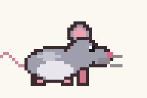

# 🐭 TopoCursor

Your mouse pointer becomes a little pixel-art mouse:

| What you do | What the mouse does |
|---|---|
| move the pointer | **runs**: the faster you move, the faster its legs go, and it turns to face where you're heading |
| stop | **rests**: breathes, twitches its whiskers, blinks |
| stay still for ~8 s | **falls asleep**, with Z's |
| click | **bites a piece of cheese**: repeated clicks make it nibble |
| drag (left button held + movement) | **hangs on to the cheese** and gets carried along, legs dangling |
| pause mid-drag | **hugs the cheese**, with a little heart |

The point that "clicks" is the **tip of its nose**.



Runs on **Windows 10/11** and on **Linux with X11** (see [Linux](#linux)).

## Project layout

```
TopoCursor.sln
assets/            config.json, mouse.png, topo.ico (shared)
src/Core/          config, PNG decoder, sprites, state machine: no platform code
src/Windows/       layered overlay, mouse hook, tray icon (WinForms)          → TopoCursor.exe
src/Linux/         X11 overlay, XInput2, XFixes                               → topocursor
tools/             generator for the default sprite sheet
```

## Windows

You need the .NET 8 SDK. Visual Studio 2022 also works: open `TopoCursor.sln`.

```powershell
.\run.ps1
```

This builds the app, starts it and waits. **Ctrl+C closes the app cleanly** and the normal pointer comes back. If PowerShell blocks scripts because of the execution policy, use `.\run.cmd`, which does the same thing.

From any terminal you can also close the running instance with `src\Windows\bin\Release\net8.0-windows\TopoCursor.exe --quit`.

To build without running: `dotnet build src\Windows -c Release`, or `dotnet build -c Release` for the whole solution.

Avoid `dotnet run` followed by Ctrl+C: the app is killed before it can clean up, and only the watchdog process puts the pointer back.

For a single exe you can put anywhere:

```bat
publish.cmd
```

`publish\TopoCursor.exe` needs the .NET 8 Desktop Runtime. `publish.cmd` also contains a self-contained variant, which has no prerequisites.

Once started, the app lives in the **system tray** (mouse icon). From its menu you can choose:

- **Paused**: the normal pointer comes back. Also available with **Ctrl+Alt+M** or by double-clicking the icon.
- **Size**: 1×, 2×, 3× or 4×
- **Hide system pointer**:
  - *Always*
  - *Arrow and hand only*: the text I-beam and the resize arrows stay visible
  - *Never*
- **Start with Windows**
- **Restore default sprites and config**: useful after an update that adds animations
- **Open sprite/config folder** and **Reload sprites**

## Linux

Works with **X11** (Xorg) sessions, with or without a compositor. **Wayland is not supported**: for security reasons, a regular app on Wayland can't read the global pointer position or draw on top of other windows. If the program detects a Wayland session, it stops and explains why.

### 1. Check that you're on X11

```bash
echo $XDG_SESSION_TYPE
```

If it prints `x11`, you're good: skip to step 2. If it prints `wayland`, it depends on your desktop:

| Desktop | X11 available? |
|---|---|
| XFCE, Cinnamon (Linux Mint), MATE, i3, Openbox and other X11 window managers | Yes, usually it's the default session. |
| KDE Plasma up to 6.7 | Yes: pick **Plasma (X11)** on the login screen. On some distros you need to install the X11 session first (on Arch, the `plasma-x11-session` package). Plasma 6.8 no longer has an X11 session. |
| GNOME up to 48 (e.g. Ubuntu 24.04 LTS, Debian 13) | Yes: on the login screen, after choosing your user, click the gear icon in the bottom-right corner and pick **Ubuntu on Xorg** / **GNOME on Xorg**. |
| GNOME 49 and later (e.g. Ubuntu 25.10 and later, Fedora 43 and later) | **No**: GNOME no longer has an X11 session. The only option is to install an X11 desktop alongside it, such as XFCE or Cinnamon, and pick that at login. |

### 2. Install the .NET 8 SDK and the X11 libraries

The X11 libraries are already present on any X11 desktop; the commands below install them in case they're missing.

**Ubuntu** (22.04 and later)

```bash
sudo apt install dotnet-sdk-8.0 libx11-6 libxext6 libxfixes3 libxi6
```

**Debian**: .NET isn't in the official repositories, so add Microsoft's repository first. The example is for Debian 12; for another release, replace `12`:

```bash
wget https://packages.microsoft.com/config/debian/12/packages-microsoft-prod.deb
sudo dpkg -i packages-microsoft-prod.deb && rm packages-microsoft-prod.deb
sudo apt update && sudo apt install dotnet-sdk-8.0 libx11-6 libxext6 libxfixes3 libxi6
```

**Fedora**

```bash
sudo dnf install dotnet-sdk-8.0 libX11 libXext libXfixes libXi
```

**Arch / Manjaro**

```bash
sudo pacman -S dotnet-sdk-8.0 libx11 libxext libxfixes libxi
```

**Any distro, without root**: use the official script, which installs into `~/.dotnet`:

```bash
curl -sSL https://dot.net/v1/dotnet-install.sh | bash /dev/stdin --channel 8.0
echo 'export DOTNET_ROOT="$HOME/.dotnet"; export PATH="$HOME/.dotnet:$PATH"' >> ~/.bashrc && source ~/.bashrc
```

To check the installation, `dotnet --list-sdks` must list an `8.x` SDK. A newer version on its own isn't enough, because running the app needs the .NET 8 runtime.

### 3. Download, build and try it

```bash
git clone https://github.com/MarBert/Topocursor.git
cd Topocursor
bash run.sh
```

`run.sh` builds only the Linux project and runs it in the terminal. **Ctrl+C** closes it cleanly, and **Ctrl+Alt+M** pauses and resumes it.

On startup it prints a line like this:

```
TopoCursor started – compositor: yes, XInput2: yes, hide pointer: yes.
```

The fields:

- **compositor**: with `yes` you get real transparency. With `no` it still works, but semi-transparent edges are cut sharply.
- **XInput2**: with `no (polling)` it still works, but very quick touchpad taps may be missed.

### 4. Install it permanently (optional)

This creates a single executable that bundles .NET, so you can copy it anywhere and no longer need the SDK.

```bash
bash publish.sh                                              # → publish-linux/topocursor (ARM: bash publish.sh linux-arm64)
install -Dm755 publish-linux/topocursor ~/.local/bin/topocursor
topocursor --autostart on                                    # starts automatically at every login
```

If the terminal says `topocursor: command not found`, then `~/.local/bin` isn't in your `PATH`. Log out and back in, or use the full path `~/.local/bin/topocursor`.

To start it right away without keeping a terminal open: `nohup topocursor >/dev/null 2>&1 &`

### Commands

```bash
topocursor                  # start
topocursor --quit           # close the running instance (from another terminal)
topocursor --autostart on   # start automatically at login (~/.config/autostart); "off" to remove it
topocursor --reset          # restore the default config and sprites in ~/.config/topocursor
topocursor --help
```

If you haven't installed it, the executable built by `run.sh` is at `src/Linux/bin/Release/net8.0/topocursor`.

### Uninstall

```bash
topocursor --quit
topocursor --autostart off
rm ~/.local/bin/topocursor
rm -r ~/.config/topocursor        # config and custom sprites
```

### Differences from Windows

- **No tray icon**: change settings in `~/.config/topocursor/config.json`, which reloads automatically as soon as you save it.
- `hideSystemCursor: "pointers"` behaves like `"all"`, because X11 can only hide the pointer as a whole.
- **The pointer can't stay invisible**: the X server hides it on the program's behalf and restores it by itself as soon as the connection closes, even if the process is killed with `kill -9`. No watchdog is needed.
- The pointer is hidden everywhere, including in apps that use a custom one.

### Troubleshooting

| Symptom | Fix |
|---|---|
| `Wayland session detected` | See [step 1](#1-check-that-youre-on-x11). |
| `Permission denied` on `./run.sh` | Run it with `bash run.sh`, or make the scripts executable with `chmod +x run.sh publish.sh`. |
| `dotnet: command not found` | The SDK isn't installed or isn't in your `PATH`: see [step 2](#2-install-the-net-8-sdk-and-the-x11-libraries). |
| `You must install .NET to run this application` | You installed .NET with the script into `~/.dotnet` but `DOTNET_ROOT` isn't set: see [step 2](#2-install-the-net-8-sdk-and-the-x11-libraries). Alternatively, use the `publish.sh` build, which bundles .NET. |
| `Unable to load shared library 'libX11.so.6'` (or `libXfixes`, `libXi`, `libXext`) | Install the X11 libraries from step 2. |
| `Can't connect to the X server` | You're starting it outside the graphical session, for example over SSH: run it from a terminal on the desktop. |
| `TopoCursor is already running` | There's already an instance, perhaps started automatically at login: `topocursor --quit`. |
| `Ctrl+Alt+M is already used by another application` | The shortcut is taken. Everything else works: use `topocursor --quit` to exit. |
| The mouse ends up under panels, menus or the lock screen | It raises itself again within a few hundredths of a second, but some desktops always keep their own panels on top. |

On Linux, building the whole solution with `dotnet build` requires the WindowsDesktop targets, which not every Linux SDK includes (distro-packaged SDKs, for example, lack them). That's why `run.sh` and `publish.sh` build only `src/Linux`.

## Changing the sprite sheet

On first run the app creates its config folder with `config.json` and `mouse.png` inside:

- **Windows**: `%APPDATA%\TopoCursor\`
- **Linux**: `~/.config/topocursor/`

You can edit them while the app is running: it reloads by itself.

If you put a `config.json` next to the executable, the app uses it instead of the config folder (portable mode).

The sheet is organized **in rows**: each animation takes one row, with its frames laid out left to right.

```jsonc
{
  "spritesheet": "mouse.png",
  "frameWidth": 48, "frameHeight": 32,
  "hotspot": { "x": 37, "y": 18 },   // frame pixel that sits under the real pointer
  "facing": "right",                 // direction the sprite faces (the app mirrors it when you move the other way)
  "scale": 2,                        // integer upscaling, nearest-neighbor
  "animations": {
    "run":   { "row": 0, "frames": 4, "fps": 12 },  // required (fps ignored: it depends on speed)
    "idle":  { "row": 1, "frames": 6, "fps": 4 },   // required
    "sleep": { "row": 2, "frames": 4, "fps": 2 },   // optional
    "bite":  { "row": 3, "frames": 7, "fps": 14 },  // required, played once per click
    "drag":  { "row": 4, "frames": 4, "fps": 12 },  // optional: dragging (fps scaled with speed)
    "hold":  { "row": 5, "frames": 4, "fps": 4 }    // optional: button held but not moving during a drag
  },
  "behavior": {
    "idleAfterMs": 140,        // how long before it stops running
    "sleepAfterMs": 8000,      // 0 = never sleeps
    "runFpsMin": 8, "runFpsMax": 22,
    "runSpeedForMaxFps": 1600, // px/s at which the run animation reaches runFpsMax
    "turnThresholdPx": 6,      // hysteresis before turning around
    "biteOn": "any",           // "left" | "right" | "any"
    "dragButton": "left",      // "left" | "right" | "middle" | "none"
    "dragThresholdPx": 5,      // movement with the button held before it counts as a drag
    "hideSystemCursor": "all"  // "all" | "pointers" (Windows only) | "none"
  }
}
```

The PNG is read by a built-in decoder (`src/Core/PngDecoder.cs`) that behaves the same on Windows and Linux. It supports all common PNG formats, but not interlaced ones.

The default sprite is generated by `tools/gen_sprites.py` (Python + Pillow). You can change colors and poses there and regenerate it with:

```
python tools/gen_sprites.py assets
```

## How it works

The logic (states, speed, direction, dragging) lives in `src/Core/PetController.cs` and is the same on both platforms. Each platform provides an overlay (`IOverlay`) and an input source.

### Windows

- **Overlay**: a `WS_EX_LAYERED | WS_EX_TRANSPARENT | WS_EX_TOPMOST | WS_EX_NOACTIVATE` popup window, drawn with `UpdateLayeredWindow` using premultiplied per-pixel alpha. Clicks pass through it and it never steals focus.
- **Input**: a `WH_MOUSE_LL` hook updates the position as soon as each event arrives and sees clicks without consuming them. A ~60 Hz timer advances the animations and falls back to `GetCursorPos`.
- **System pointer**: replaced with a transparent cursor via `SetSystemCursor`. It is restored by reloading the user's cursor scheme with `SystemParametersInfo(SPI_SETCURSORS)`. Restoring happens:
  - on exit
  - on a crash
  - from a small *watchdog* process, which notices even when the app is killed from Task Manager or stopped by the debugger
- **Not a Windows Service**: services run in session 0 and can't draw on the desktop. To start at login, use the **Start with Windows** option, which writes a key under `HKCU\...\Run`.

### Linux (X11)

- **Overlay**: an *override-redirect* window, so the window manager doesn't manage it and it has no decorations. Its input shape is empty, so clicks pass through. With a compositor it uses a 32-bit ARGB visual with per-pixel alpha. Without one, the outline is cut out with a bounding shape. Each frame is a server-side Pixmap, set as the window background.
- **Input**: XInput2 *raw* events on the root window. They arrive immediately, even while another app holds an active grab (for example while you drag an icon), and also for very short touchpad taps. Without XInput2 it falls back to polling `XQueryPointer`.
- **System pointer**: `XFixesHideCursor` on the root window.
- **Always on top**: every ~45 ms it uses `XQueryTree` to check whether a visible window has ended up above it, and if so raises itself again.

## If the pointer stays invisible (Windows)

This only happens if both the app and the watchdog die. You have three ways to get it back:

- start TopoCursor again and close it
- run `TopoCursor.exe --restore` (Win+R)
- log out

## Known limitations

- On Windows, apps that set their **own** custom pointer keep showing it on top of the mouse. Examples: some games, CSS cursors in browsers, 3D software.
- The overlay lags 1–2 frames behind the hardware pointer. You won't notice in normal use, but you will in games: pause it with Ctrl+Alt+M.
- On every frame the mouse checks whether a window has ended up above it (menus, tooltips, taskbar, a dragged icon, "always on top" apps) and moves back to the top. Some windows still stay above it, because Windows keeps them in a higher "band" reserved for the shell and for signed accessibility apps: the Start menu, search, Alt+Tab, Task View, the notification center, Game Bar.
- It doesn't appear over exclusive full-screen games or on the UAC secure desktop.
- On Linux, some compositors or desktops may show their own panels or lock screens above the mouse. It raises itself again, but only if the compositor allows it.
